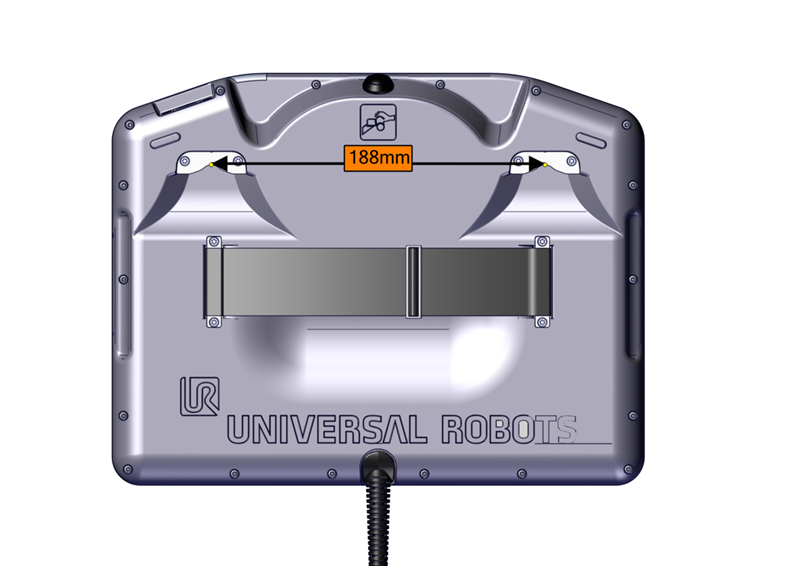

# 22 — Hardware e desenhos dimensionais

**Fontes:** U5E p.41–67, 98; UR5DS p.1; DWG1000698 p.1–2; OEMDWG p.1; UR10DWG p.1–19; TPIMG. Conferência visual das cotas citadas e da folha CB3.0; não equivale à revisão elétrica integral.

## Identidade antes da cota

| Fonte | Identidade | Aplicação |
|---|---|---|
| UR5DS | UR5, EN 09/2016, item 110105 | Ficha histórica, não UR5e |
| U5E | UR5e, copyright 2021 | Conferir edição/hardware |
| DWG1000698 | UR5e Working Area, rev.0, 28/05/2018 | Vistas cotadas, não modelo de colisão |
| OEMDWG | e-Series OEM AC & DC, 1005703 rev.03-00, 29/08/2019 | Distinguir caixa OEM da padrão |
| UR10DWG | UR10 CB3.0/CB3.1 rev.3.0.0.2, 24/11/2015 | Não é esquema e-Series |
| TPIMG | Vista traseira de Teach Pendant | Apenas cota indicada de 188 mm |

UR5DS informa massa 18,4 kg e repetibilidade ±0,1 mm; U5E p.98 informa UR5e com 20,7 kg e repetibilidade de pose ±0,03 mm por ISO 9283. Ambos citam 850 mm de alcance e 5 kg de carga, mas isso não torna hardware, interfaces e certificações intercambiáveis. São dados das edições fornecidas.

## Ler cotas na vista correta

DWG1000698 p.1 indica Recommended Reach **Ø1700** e Max. working area **Ø1892**, em mm. São diâmetros; Ø1892 não é raio nem alcance garantido de qualquer pose do TCP. Ferramenta, orientação, peça e obstáculos alteram o volume necessário. A p.2 detalha segmentos do braço; usar o referencial da vista para cotar.

OEMDWG mostra comprimento indicado de 414,5 mm, referência superior de 260 mm e prolongamentos de 77,2 mm AC / 84,20 mm DC. Não transformar cotas em padrão de furação sem ler a vista. Embora o nome do arquivo contenha 1005747, o cartucho conferido identifica 1005703; não alegar dois desenhos verificados.

TPIMG sustenta somente a distância marcada. Não informa rosca, tolerância, padrão VESA, carga admissível ou compatibilidade de suporte.

## Interfaces e esquema elétrico

U5E p.46–67 separa rede elétrica, braço, controlador, ferramenta e Ethernet. Diferenciar PE de proteção, GND de alimentação/sinal e blindagem. Orçar corrente por canal e total; IG p.9 alerta contra interligar fontes internas/externas 24 V indiscriminadamente. Não transferir limites da ferramenta UR5 antiga para UR5e.

UR10DWG: p.3 visão geral; p.4 controlador CB3.0; p.5 CB3.1; p.6 braço; p.7–18 I/O; p.19 ferramenta. A página física 4 é folha impressa 11. A folha CB3.0 mostra Compact Flash, distinta da arquitetura CB3.1. Texto extraído não preserva cruzamentos/conexões: não deduzir pinagem completa somente dele.

**Técnica:** para dimensão ou ligação, declarar modelo, revisão, vista/folha, unidade e ponto exato. Se faltar identidade, registrar a lacuna em vez de interpolar outra geração.

## Complemento CB3 e artigos de referência — 2026-10-28

IPG/IPD são a mesma referência geral Holland Shielding Systems, revisão2017, e não atribuem proteção a produtosUR. TQ lista conexões UR3/5/10 sem revisão confirmada, não tabela e-Series. Ver ch34/ch35.

## Complemento do lote ampliado — 2026-10-28

Dimensões e ambiente daOEMACFlexTail emN16 diferem do desenho2019. ClassificaçãoIP,toolI/O e massa mudam por modelo; ch36/47/48/53. Não escolher cabo apenas pela cor ou flange.
